## Blussans

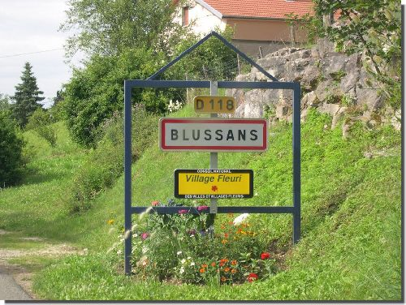

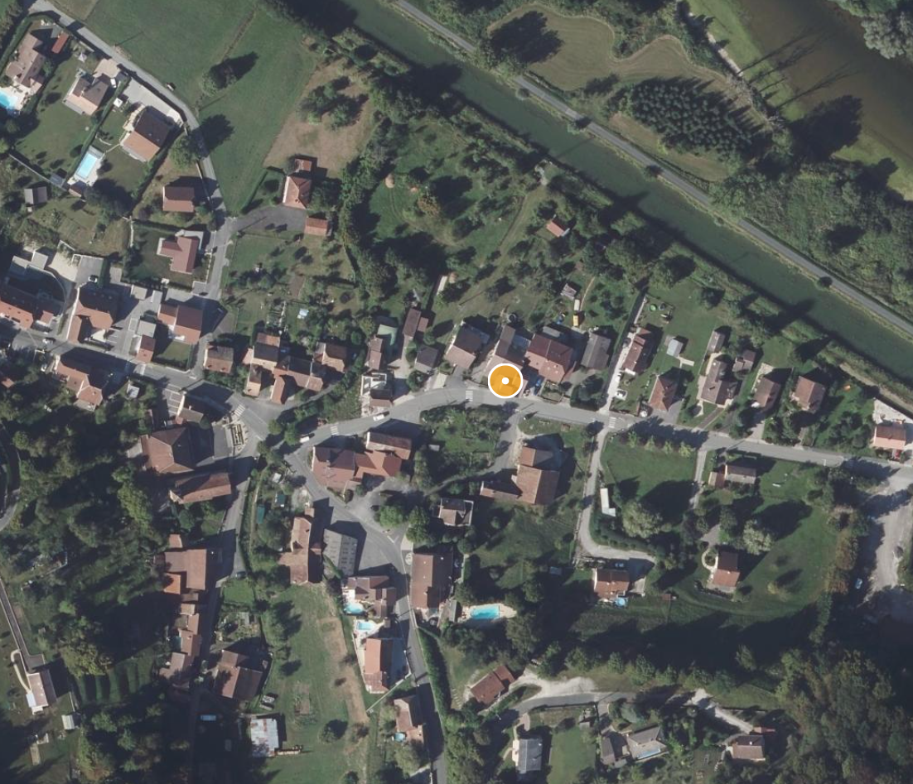

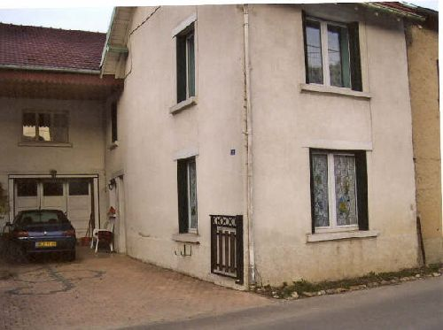

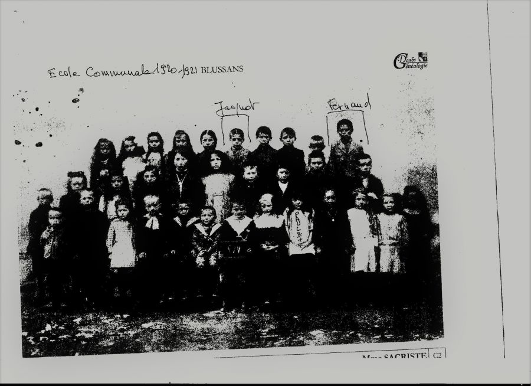

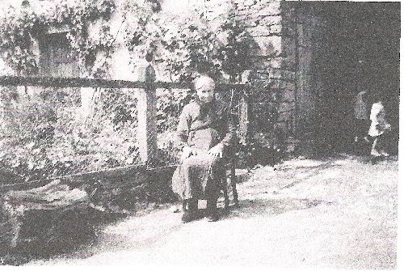

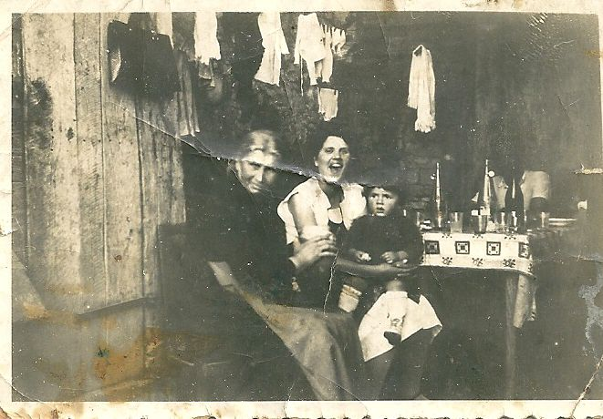

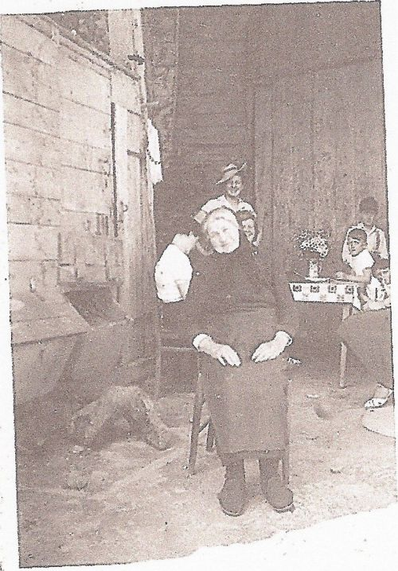

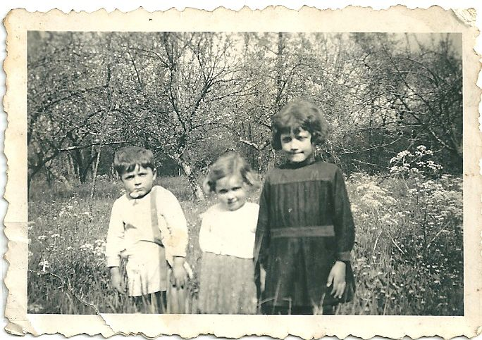

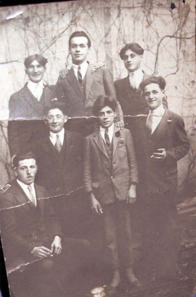

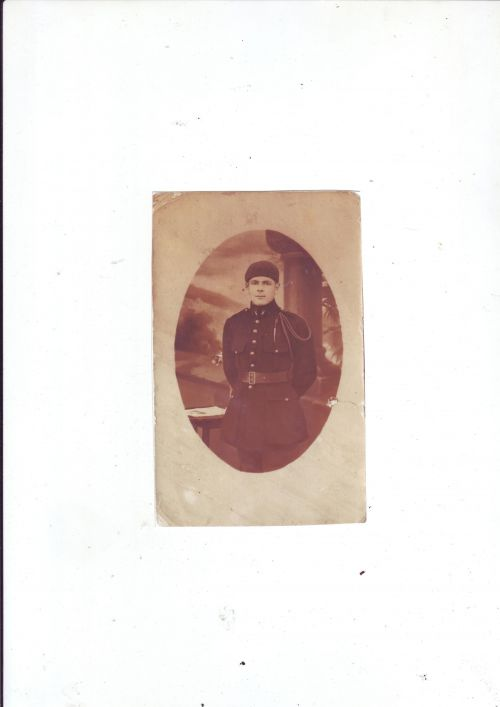

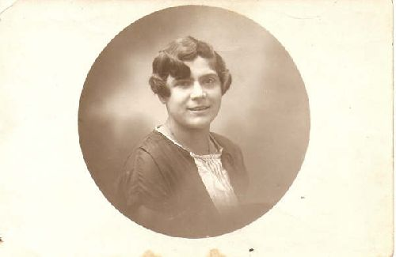

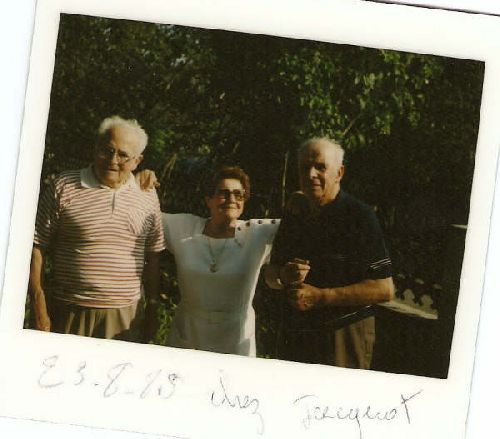

Paulette, la plus jeune, très jeune orpheline, élevée par "maman Lina", sa grand-mére, papa léon son grand-pére et ses tantes : Marguerite, Gaby, Berthe, Julia et son mari Samuel. Paulette se rendait tous les jours à pied à l'école à l'Isle-sur-le-Doubs (soit 9 kilomètres aller-retour), et étudiait le soir à la lumiére d'une chandelle ou d'une lampe à pétrole, ce qui lui a permis de devenir institutrice. Jacquot, cadre chez Peugeot, fait prisonnier par les Allemands, réussit à s'évader lors de sa deuxieme tentative, sérieusement blessé lors de la premiére tentative; Père de Monique et Nelly. Fernand était l'ainé (voir sa photo individuelle).

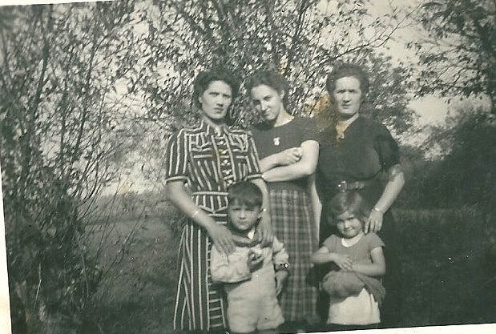

