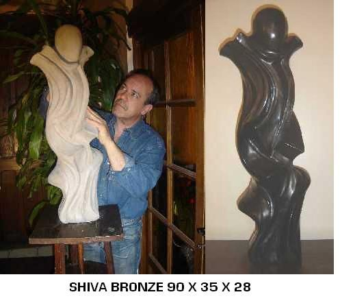

## Didier Figent et sa représentation de Shiva

Didier est le fils ainé de Mireille Giboulot et de Marcel Figent. Il est sculpteur, installé à Baume-Les-Dames. Sa renommée s'étend actuellement à l'international. Il vient de reçevoir le trophée Européen du Bronze au Concours International de 2008,organisé par la Fédération Nationale de la Culture. Il expose en permanence au Grand Palais des Champs-Elysées à Paris, à la Refence Gallery à New-York. Il est prêt à vous faire visiter son atelier à Hyèvre-Paroisse (près de Baume).

Téléphone: 03 61 84 35 74.

Adresse mail: didier.figent@wanadoo.fr

Site internet: www.didierfigent.com

