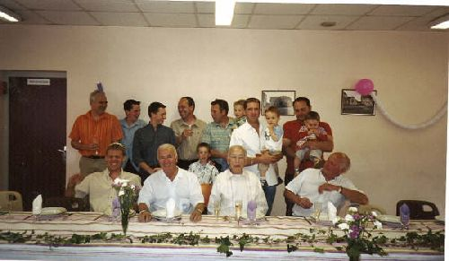

## Les mâles Giboulot en 2005

Assis: Philippe, compagnon de Frédérique, fille de Jeanine, Roland, Marcel Figent (époux de Mireille), Denis, frère de Roland, qui tente d'éviter un tacle de son petit-fils.

Debout:

- Frédéric (en chemisette rouge), fils de Marcel et Mireille,
- Antony fils de Didier Figent,
- Pascal mari de Caroline(fille de Denis)
- Didier,
- Son autre frère Stéphane et son fils,
- Jérôme (fils de Jeanine) et son fils
- Emmanuel (fils de Denis) et son fils.

Ne manquent que Philippe et Cédric.

