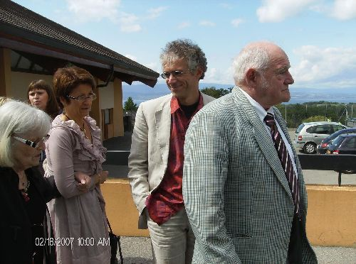
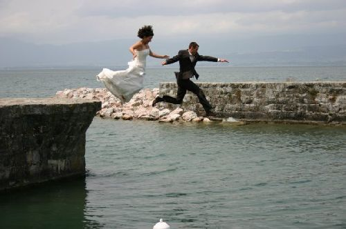
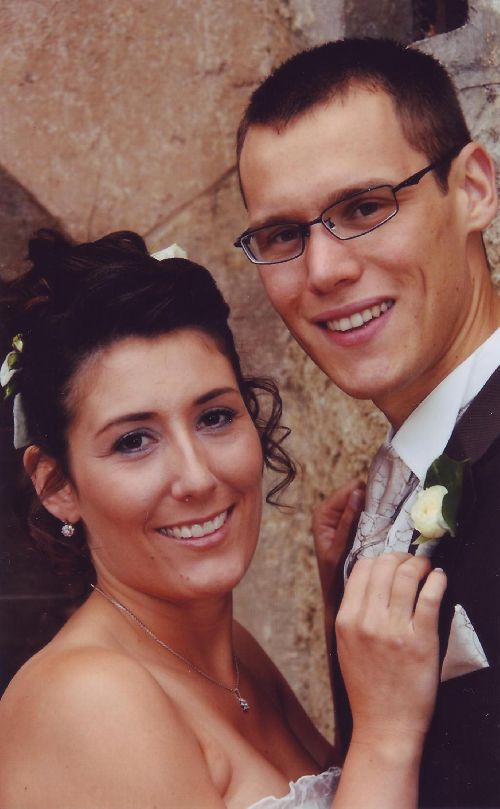
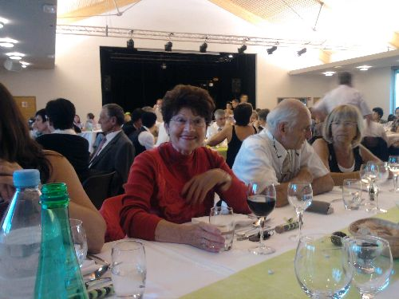

## Mariage de Sophie Colin et de Samuel Cange

Ce mariage s'est déroulé le 18 Juillet 2009 à Allinges. Sophie est la petite-fille de Gérard Waille et de Françine, fille d'Yveline et de Daniel Colin. Tous nos voeux de bonheur aux jeunes mariés.

Après leur mariage, Sophie et Samuel ont eu une idée tres personnelle de symboliser leur grand saut dans la vie, par un véritable saut dans le lac Léman : "Un grand saut dans le Leman, du bonheur pour cent ans".

