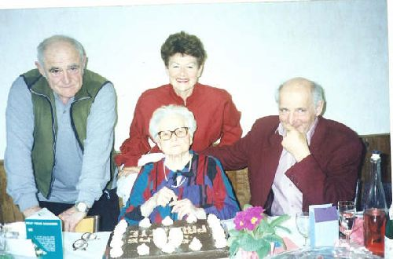

## Paulette et ses enfants

Gérard, Michèle et Yves: Aux 90 ans de Paulette dans les environs de Poligny en Juin 2002. Gérard, retraité de l'usine Solvay chimie de Tavaux, ancien responsable départemental du syndicat FO, père de Yveline, Catherine et Éric. Humaniste, philosophe social et producteur de bons vins du Jura! Michèle, artiste lyrique, professeur d'éducation musicale en retraite et spiritualiste religieuse engagée. Yves,très connu sous le surnom affectueux de "Titi", médecin radiologiste, écologiste, humaniste et psycho-spiritualiste. Père de Franck, Pierrick et Agnès.

