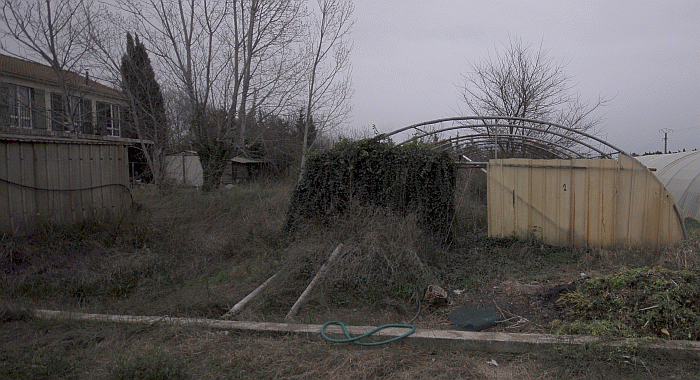
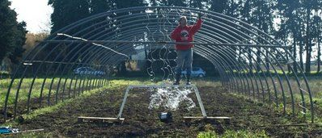
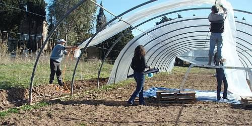
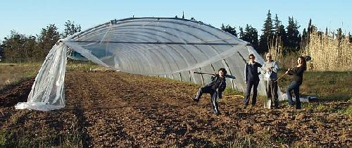
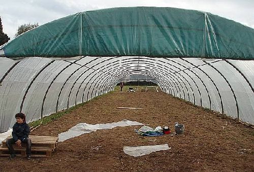
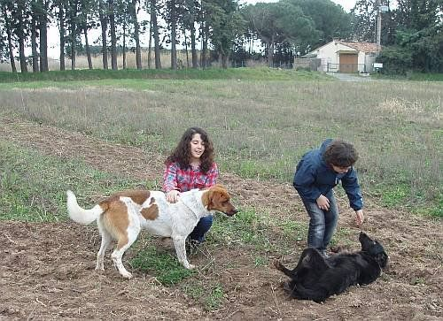
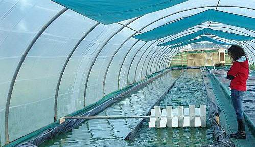

## Serre

Philippe se lançe dans la culture de la spiruline à Fréjus: 

1. Acheter une vielle serre d'occasion et la démonter.

2. la transporter à bord du Picasso et la remonter, travail effectué par Philippe en solo.

3. Recouvrir la serre avec 350 m2 de toile. Cett fois-çi toute la famille participe.

