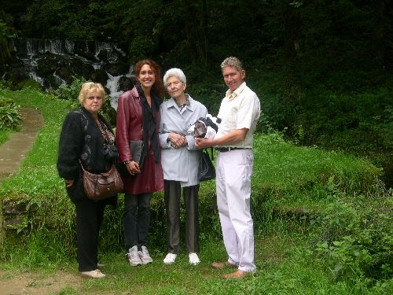

## "Zonzon", son fils et sa petite-fille

Suzanne Pelletier dite "Zonzon", cousine germaine de Fernand, Jacques et Paulette, avec son fils Patrick, sa petite fille Monique Marie et Monique. Enfants, Gérard, Monique et Michèle passaient souvent leurs vacances à Bart (Doubs), chez les parents de Zonzon.

